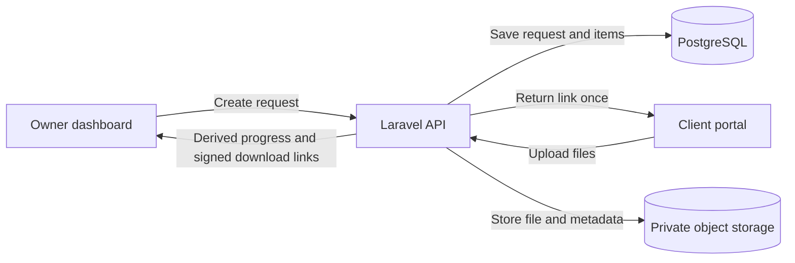

# Sendocs

Sendocs is a small document-collection app for professionals who need files from a client without asking them to create another account. An owner creates a request, shares one link, and tracks the files as they arrive.

It is designed for work like client onboarding, where the process often ends up spread across email threads and attachments.

## What it does

- Create a request with a named list of required documents.
- Share a client portal link that works without a client account.
- Track which items have arrived and which are still waiting.
- Download uploaded files from the owner dashboard.
- Revoke a client link or delete a document when it is no longer needed.
- Support owner sign-in with email/password and Google OAuth.

## How it fits together

The owner uses the dashboard to create a request. Sendocs returns the client link once; the client opens it, uploads the requested files, and can return to the same link until it expires or is revoked. The owner sees progress in the dashboard.

The web app and API are separate parts of the same repository. The browser uses one origin for the UI and API requests, while PostgreSQL stores application records and object storage holds file contents.

## Stack

| Area | Technology |
| --- | --- |
| API | Laravel 13, PHP 8.4 |
| Web | React, TypeScript, Vite |
| Database | PostgreSQL |
| File storage | S3-compatible object storage in the intended deployment architecture |
| Background work | Laravel queue worker and scheduler |
| Local services | Docker Compose |
| Automation | GitHub Actions |

## Engineering decisions worth looking at

- **A client does not need an account.** The request link is the credential for the portal.
- **Only a hash of the magic-link token is stored.** The raw link is returned when the request is created and is not exposed by later API responses.
- **Dead links do not disclose why they failed.** Unknown, expired, and revoked links use the same response.
- **Files stay private.** Downloads are authorized by the API and use short-lived signed URLs rather than public object URLs.
- **Progress is derived from uploaded documents.** It is not stored as a counter, so deleting a document can correctly return an item to the waiting state.
- **Database constraints back up application rules.** A request item can have only one document, and request creation keeps its items together in a transaction.
- **Owner access is scoped to the signed-in owner.** A user should not be able to discover another owner's request by changing an identifier.

These are design goals and implementation rules; the feature documents describe the details and trade-offs.

## Repository guide

- [Technical design](docs/design.md) — architecture, data model, and operational considerations.
- [Technical decisions](docs/decisions.md) — why the main stack and security choices were made.
- [Repository structure and services](docs/structure.md) — directories, containers, environment variables, and commands.
- [Deployment and releases](docs/deployment.md) — staging, tagged production releases, and current deployment limitations.
- [Frontend conventions](docs/frontend.md) — shared rendering and data-handling rules.
- [OpenAPI contract](docs/openapi.yaml) — versioned API endpoints, payloads, and errors.

Feature behavior has its own source-of-truth document:

- [Authentication and access](docs/features/auth-and-access.md)
- [Document requests](docs/features/document-requests.md)
- [Secure magic links](docs/features/secure-magic-link.md)
- [Progress tracking](docs/features/progress-tracking.md)
- [Owner dashboard](docs/features/owner-dashboard.md)
- [Client portal](docs/features/client-portal.md)

## Development

Sendocs is organized around Docker Compose so the API, web app, worker, scheduler, and database can be run as a local stack. The service layout and environment variables are documented in [docs/structure.md](docs/structure.md).

The repository's root command manifest and the API's local database defaults still need to be reconciled with that setup, so I am not listing a copy-and-paste startup command here until it has been checked end to end. Once that is resolved, this section should be the quick-start path for a fresh checkout.

## Checks and delivery

GitHub Actions currently defines separate checks for the API and web app in [CI](.github/workflows/ci.yml). The API job runs the Composer test suite; the web job runs its lint/type checks, unit tests, and Playwright tests.

The [production image workflow](.github/workflows/build.yml) builds the API and web Docker production targets. Staging and production deployment workflows are also present; the release process and its operational limits are documented in [docs/deployment.md](docs/deployment.md).

Workflow files describe what is configured to run. Check the latest Actions run for the result on a particular commit.

## Demo

A public demo and a short walkthrough will be added here when the demo environment is ready. No demo URL is published yet.

## Project status

Sendocs is an active portfolio project. The focus is on making the core document-request workflow dependable, documenting the security and data-integrity decisions, and making setup and releases repeatable. The design documents are kept alongside the code so implementation changes can be reviewed against an explicit contract.
